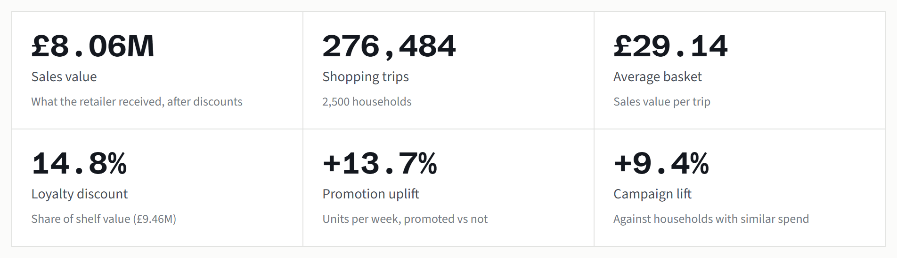
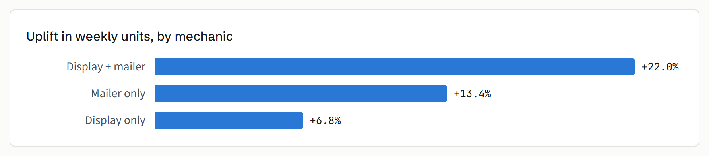
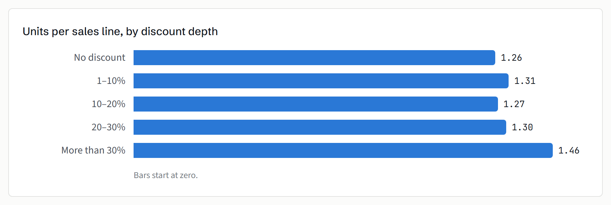
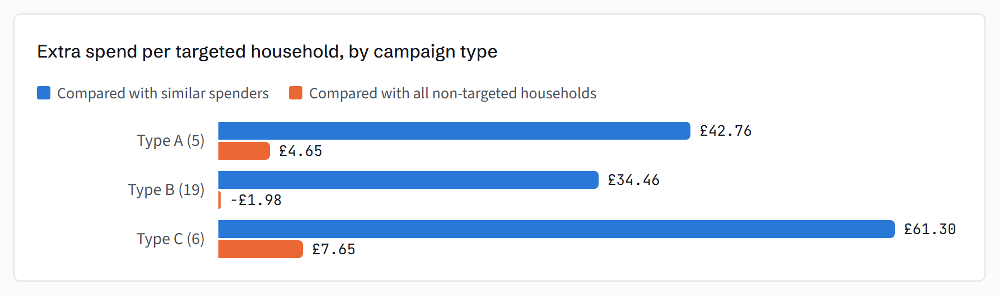
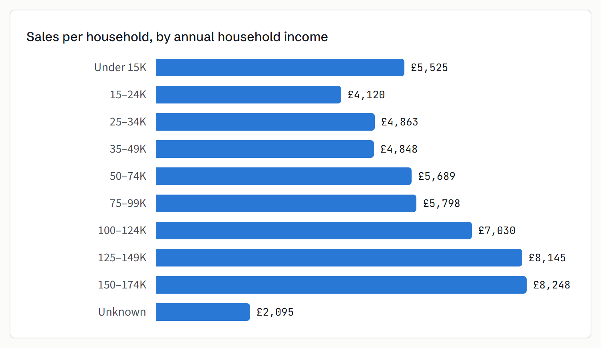
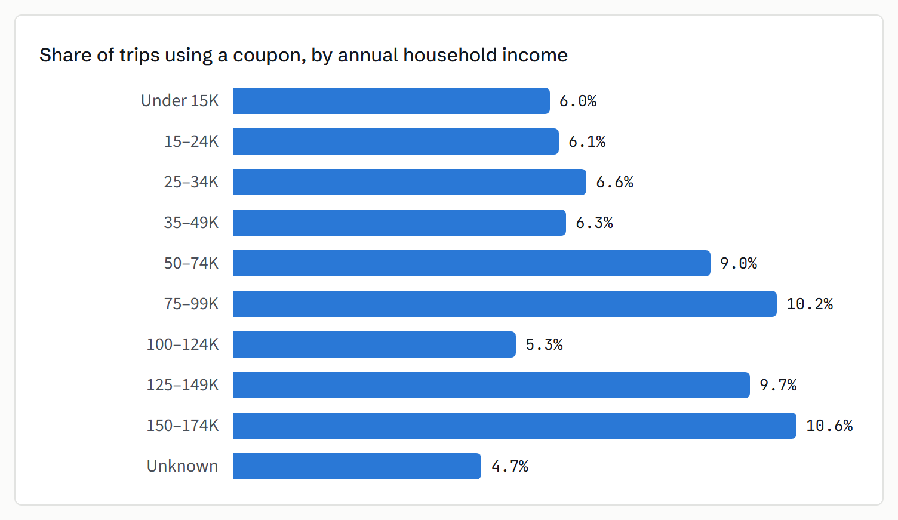

###### END-OF-PROJECT REPORT · RETAIL PROMOTIONS ANALYTICS

# Which promotions, discounts and campaigns paid off

Two years of grocery shopping by 2,500 households (dunnhumby, *The Complete Journey*), modelled in Microsoft Fabric
and dbt and reported in Power BI. This report gives the findings and what they suggest doing.

Study days 1–711 · weeks 1–102 · 2,595,732 sales lines

**[Open the interactive Power BI report →](https://app.powerbi.com/view?r=eyJrIjoiN2QzOWE3NmUtZGMwMS00YTY1LTlmMjAtZGIwNDJkM2EyYWQ3IiwidCI6IjUyNzFkN2Y2LWUxMGItNGY2Yi1hMjEzLTRiY2MzZjM1ZGQyYyJ9&pageName=2d998bfd249881af)**

## Headline figures

## Summary

| | |
|---|---|
| **Promotions** | Combining an in-store display with a mailer feature lifted weekly unit sales by 22%. A mailer alone gave 13%, a display alone 7%. Display on its own is the weakest mechanic in almost every department. |
| **Discount depth** | Discounts between 1% and 30% barely change how many units a shopper puts in the basket (1.27–1.31 per line against 1.26 at full price). Only discounts above 30% show a clear jump, to 1.46. |
| **Private label** | Own-label share held steady: 21.2% of merchandise sales in year 1, 21.5% in year 2. Packaged meat gained most (+2.8 points). |
| **Campaigns** | Targeted households spent £41 more per campaign than similar households that were not targeted (+9.4%). Type A campaigns had the best response; Type C produced the largest lift per household. |
| **Customers** | Higher-income households spend more and mostly use coupons more: 9–11% of trips in the 50–99K and 125–174K bands, against about 6% under 50K. The top bands are small, so this is directional. |

---

###### FINDING 1

## Display plus mailer is the mechanic that earns its place

For each product in each store we compared average units sold in weeks when it was promoted with weeks when it was
not. The comparison uses the 115 stores where promotions were tracked, weeks 9–101, merchandise only, and the 166,725
product-store pairs that had both kinds of week.

| Department | Display + mailer | Display only | Mailer only |
|---|---:|---:|---:|
| Packaged meat | +26.8% | +7.0% | +19.0% |
| Produce | +19.5% | +1.9% | +19.2% |
| Grocery | +21.7% | +7.5% | +12.1% |
| Drug / general merch. | +18.6% | +3.4% | +13.1% |
| Packaged seafood | +13.0% | −2.1% | +16.3% |

> **A mailer feature does most of the work. Adding a display to it adds about 9 points; a display without a mailer
> adds little, and in packaged seafood it showed no uplift at all.**

Departments shown have at least 100 product-store pairs in each cell. Baseline weeks are weeks with sales, so the
uplift is in units per selling week, not total demand.

###### FINDING 2

## Shallow discounts do not move volume

Discount depth is the loyalty discount as a share of shelf price, measured on each sales line in commodities with at
least 1,000 lines. Almost half of all units (47.6%) sell at full price, and 22.5% sell at more than 30% off.

> **Between 1% and 30% off, shoppers buy about the same quantity as at full price. Discounts in that range are giving
> away margin for little extra volume.**

This is units per line, not whether a product is bought at all. A discount can still win the purchase without
changing the quantity.

###### FINDING 3

## Own-label share is flat overall, with some movement by department

Private-label share of merchandise sales went from 21.2% in year 1 to 21.5% in year 2. The departments that moved
most:

| Department | Year 1 | Year 2 | Change |
|---|---:|---:|---:|
| Packaged meat | 21.1% | 23.9% | +2.8 pts |
| Nutrition | 7.8% | 8.9% | +1.1 pts |
| Pastry | 51.9% | 51.3% | −0.7 pts |
| Packaged seafood | 63.1% | 62.1% | −1.1 pts |
| Floral | 8.7% | 7.3% | −1.4 pts |
| Seafood | 3.5% | 1.7% | −1.8 pts |

Year 2 is shorter (346 days against 365). Shares are ratios, so the shorter year does not bias them, but seasonal
mix can.

###### FINDING 4

## Campaigns lifted spend, once compared fairly

For each campaign we compared the change in spend per household, from an equal-length window before the campaign to
the campaign itself, between targeted households and households that were not targeted. Targeted households already
spent about twice as much before a campaign, so the main estimate compares them only with non-targeted households in
the same pre-campaign spend band.

| Campaign type | Campaigns | Lift | Extra spend / household | Coupon redemption |
|---|---:|---:|---:|---:|
| Type A | 5 | +10.5% | £42.76 | 16.0% |
| Type B | 19 | +8.3% | £34.46 | 8.0% |
| Type C | 6 | +7.8% | £61.30 | 7.7% |
| **All** | **30** | **+9.4%** | **£41.28** | **12.4%** |

> **The simple comparison suggests campaigns did almost nothing (£2.51 per household). Comparing like with like shows
> £41.28. Judging campaigns without matching would have undervalued them.**

This is an observational estimate, not a randomised test. A household in the comparison group can be targeted by
another campaign running at the same time, which would make the estimate conservative.

###### FINDING 5

## Higher-income households spend more and use more coupons

Only 801 of the 2,500 households have demographics. The other 1,699 are kept as "Unknown" rather than dropped.
Segments with fewer than 10 households are left out.

  
  

> **Households earning 100–174K spend £7,000–8,250 each over the two years, against £4,100–5,500 for households under
> 50K, and coupon use is higher in most upper bands. Households without demographics are the lightest shoppers, so the
> demographic view describes the more engaged part of the panel.**

The dataset gives income as anonymised levels 1–12; the ranges are the bands of its original public release,
which match the levels household for household. The 100–124K band is an exception to the coupon pattern at 5.3%. The
three bands from 100K to 174K hold only 12, 29 and 13 households, so treat differences between individual bands as
directional.

---

## Recommendations

1. **Pair displays with a mailer feature.** Review standalone display slots, starting with the departments where
   display alone shows little or no uplift, such as packaged seafood and produce.
2. **Test fewer, deeper discounts.** Discounts of 1–30% do not change basket quantity. Run a controlled test that moves
   some of that spend to 30%+ offers on fewer lines, and measure margin as well as units.
3. **Keep Type A campaigns and look at Type C economics.** Type A has the best redemption and percentage lift. Type C
   gives the largest lift per household, so its cost per household decides whether it pays.
4. **Measure every campaign against matched households.** The unmatched comparison understated the effect by about £39
   per household. The matched method is built into the data model and can be reused for future campaigns.
5. **Fill the demographic gap.** Two-thirds of households have no demographics. Better coverage would make segment
   targeting decisions more reliable.

## Data notes

- The data has relative days and weeks, not calendar dates. Day 1 is anchored to a date only so the report can show a
  timeline.
- Only 801 of the 2,500 households have demographics. The rest are kept as "Unknown" rather than dropped.
- Campaign results are an observational estimate, not a randomised test.
- In 0.04% of promotion records the same product, store and week had conflicting codes. The row with the most
  promotion was kept and the other logged.

Source: dunnhumby, *The Complete Journey*.
