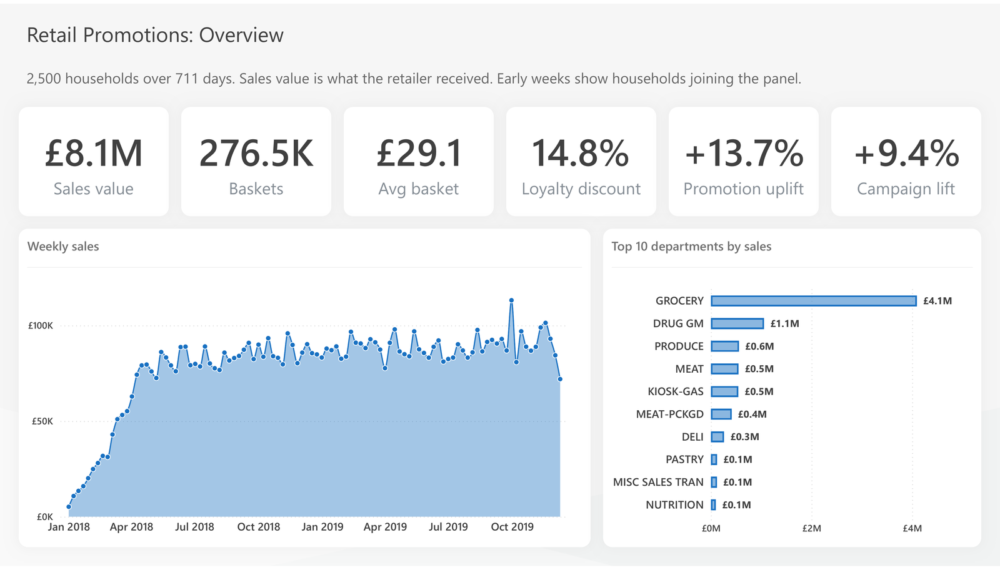

# Retail Promotions Analytics

**Which promotions, discounts and campaigns paid off?** Two years of grocery shopping by 2,500 households
(dunnhumby, *The Complete Journey*), modelled in Microsoft Fabric and dbt and reported in Power BI.

**[Open the interactive report](https://app.powerbi.com/view?r=eyJrIjoiN2QzOWE3NmUtZGMwMS00YTY1LTlmMjAtZGIwNDJkM2EyYWQ3IiwidCI6IjUyNzFkN2Y2LWUxMGItNGY2Yi1hMjEzLTRiY2MzZjM1ZGQyYyJ9&pageName=2d998bfd249881af)**
(Power BI, five pages, no sign-in needed)



## Headline figures

| Sales value | Shopping trips | Average basket | Loyalty discount | Promotion uplift | Campaign lift |
|---:|---:|---:|---:|---:|---:|
| £8.06M | 276,484 | £29.14 | 14.8% of shelf value | +13.7% | +9.4% |

Study days 1–711 (weeks 1–102), 2,595,732 sales lines. Sales value is what the retailer received after discounts.

## Findings

**1. Display plus mailer is the mechanic that earns its place.** For each product in each store, weekly unit sales
in promoted weeks were compared with weeks without a promotion (115 tracked stores, merchandise only, 166,725
product-store pairs).

| Mechanic | Uplift in weekly units |
|---|---:|
| Display + mailer | +22.0% |
| Mailer only | +13.4% |
| Display only | +6.8% |

A mailer feature does most of the work. A display without a mailer adds little, and in packaged seafood it showed no
uplift at all (−2.1%).

**2. Shallow discounts do not move volume.** Shoppers buy 1.26 units per line at full price and 1.27–1.31 units at
1–30% off. Only discounts above 30% show a clear jump, to 1.46. Almost half of all units (47.6%) sell at full price.

**3. Own-label share is flat.** Private label was 21.2% of merchandise sales in year 1 and 21.5% in year 2. Packaged
meat gained most (+2.8 points); seafood and floral lost share.

**4. Campaigns lifted spend, once compared fairly.** Targeted households already spent about twice as much as
everyone else, so each campaign is measured against households with similar spend before it started.

| Campaign type | Campaigns | Lift | Extra spend per household | Coupon redemption |
|---|---:|---:|---:|---:|
| Type A | 5 | +10.5% | £42.76 | 16.0% |
| Type B | 19 | +8.3% | £34.46 | 8.0% |
| Type C | 6 | +7.8% | £61.30 | 7.7% |
| **All** | **30** | **+9.4%** | **£41.28** | **12.4%** |

A simple comparison against all non-targeted households shows only £2.51 per household and would have undervalued
the campaigns.

**5. Higher income bands spend more and use more coupons.** Income Levels 7–9 spend £7,000–8,250 per household over
the two years, against £4,100–5,500 for Levels 1–4. Coupons are used on 9–11% of trips at Levels 5, 6, 8 and 9, and on
about 6% at Levels 1–4; Level 7 is the exception at 5.3%. The top bands hold 12–29 households each, so treat band-level differences as directional.

## Recommendations

1. **Pair displays with a mailer feature.** Review standalone display slots, starting with departments where display
   alone shows little or no uplift, such as packaged seafood and produce.
2. **Test fewer, deeper discounts.** Discounts of 1–30% do not change basket quantity. A controlled test moving some of
   that spend to 30%+ offers on fewer lines would show whether margin and units both improve.
3. **Keep Type A campaigns and check Type C economics.** Type A has the best redemption and percentage lift. Type C
   gives the largest lift per household, so its cost per household decides whether it pays.
4. **Measure every campaign against matched households.** The unmatched comparison understated the effect by about
   £39 per household. The matched method is built into the data model and can be reused.
5. **Fill the demographic gap.** Two-thirds of households have no demographics, which limits segment targeting.

## The report

| Page | Question it answers |
|---|---|
| Overview | How did the business perform over the two years? |
| Promotions | Which promotion mechanic earns its place, and in which departments? |
| Discounts and Private Label | Are discounts deep enough, and is own-label growing? |
| Campaigns | Did campaigns lift spend against comparable households? |
| Customers | Which segments are most valuable and most promotion-sensitive? |

Each page states its main caveat under the title.

## How it was built

```
 CSV files ──► lh_bronze ──────► lh_silver ──────► wh_gold (dbt) ──────► Power BI
               raw, as landed    typed, cleaned    star schema +         Fabric report and
               (Spark)           (Spark)           analysis tables       Desktop version
```

- **Microsoft Fabric** lakehouses and warehouse, with Spark notebooks for loading and cleaning.
- **dbt** builds a star schema of 8 dimensions and 5 facts, plus 5 analysis tables, all tested: contracts,
  relationship tests, reconciliation tests and a unit test on the pricing logic. It runs as a Fabric dbt job.
- **GitHub** pull requests for every change, with CI on each pull request and a dev-to-prod deployment pipeline.
- **Power BI** report on a Direct Lake semantic model in Fabric, plus an import-mode copy for Power BI Desktop.

Details, set-up and run instructions: [technical guide](docs/technical_guide.md) ·
model design: [star schema](docs/star_schema.md).

## Data notes

- The data has relative days and weeks, not calendar dates; day 1 is anchored to a date only to draw timelines.
- Only 801 of the 2,500 households have demographics. The rest are kept as "Unknown" rather than dropped.
- Campaign results are an observational estimate, not a randomised test.
- In 0.04% of promotion records the same product, store and week had conflicting codes; the row with the most
  promotion was kept and the other logged.

Source: dunnhumby, *The Complete Journey*.
